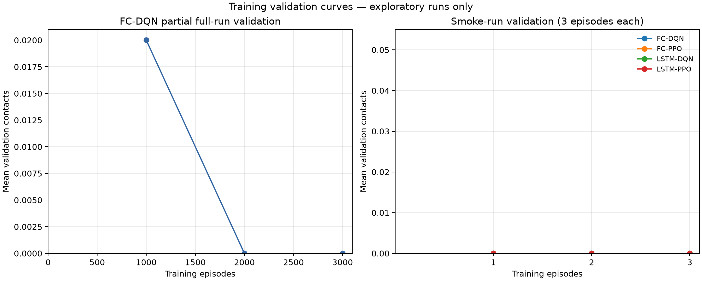
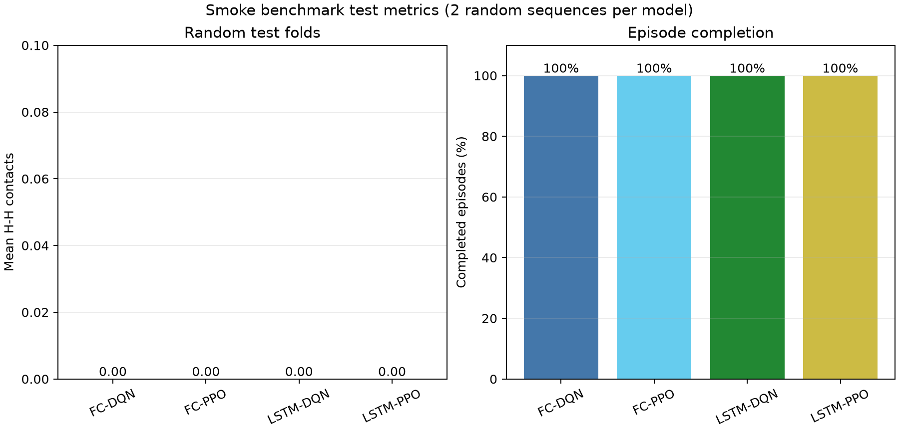

# Protein-folding experiment results

## Scope and status

- All four architecture/algorithm combinations completed the smoke run:
  FC-DQN, FC-PPO, LSTM-DQN, and LSTM-PPO.
- Each smoke run used seed 7, trained for 3 episodes, evaluated 2
  validation sequences after each episode, and tested 2 random sequences
  in addition to the 2 fixed benchmark sequences.
- The full 100,000-episode, three-seed matrix is **not complete**.
  Only FC-DQN seed 7 has a partial saved full-run validation trace.

## Smoke test results

| Model | Timesteps | Mean contacts (2 random tests) | Completion rate |
|---|---:|---:|---:|
| FC-DQN | 63 | 0.00 | 100% |
| FC-PPO | 61 | 0.00 | 100% |
| LSTM-DQN | 136 | 0.00 | 100% |
| LSTM-PPO | 65 | 0.00 | 100% |

The smoke models completed both random test episodes (100% completion)
but achieved 0.00 mean H-H contacts across the two random test
sequences. The short run and tiny test sample are only a pipeline
check, not evidence of learned folding performance.

### Fixed benchmark sequences

| Model | 20mer-A energy | 20mer-B energy |
|---|---:|---:|
| FC-DQN | 0 | 0 |
| FC-PPO | 0 | 0 |
| LSTM-DQN | 0 | 0 |
| LSTM-PPO | 0 | 0 |

## Partial full-run training trace

FC-DQN seed 7 has validation entries through 3,000 episodes. The best recorded mean validation score was 0.02 contacts; at the last recorded point it was 0.00. This is an incomplete run and must not be compared as a trained model.

## Charts

The validation plots show the incomplete FC-DQN trace separately
from the three-episode smoke curves. Test-metric bars summarize
only the two random test sequences per smoke model.
